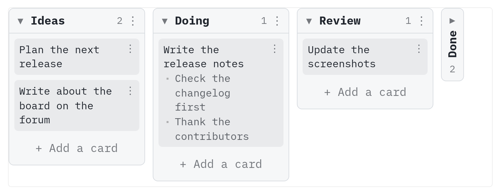

# SilverBullet Kanban

A Kanban board for [SilverBullet](https://silverbullet.md) 2, drawn from a plain Markdown page. Each `##` section is a column, and each top-level task under it, with its indented lines, is a card.

<picture>
  <source media="(prefers-color-scheme: dark)" srcset="docs/board-dark.png">
  
</picture>

```markdown
${kanban.board()}

## Doing

- [ ] Write the release notes
	- Check the changelog first

## Done

- [x] Tag the release
```

## Features

- Dragging cards, sub-items included, to reorder them or move them to another list, and dragging lists by their title.
- Adding cards with `+ Add a card`, and a `⋮` menu on each card and list to edit, check, move, insert, rename, or delete.
- Inserting kanban boards from other pages with `${kanban.board("Some/Page")}`.
- Folding a list with its chevron. To have lists start folded, name them on the board: `${kanban.board{ folded = {"Ideas", "Chores"} }}`
- Pass `${kanban.board{ checkboxes = true }}` to check cards from a box on each.
- The `Kanban: Insert Board` command inserts a board at the cursor.
- Note: a heading of another level or a `%%` comment ends the board, so notes can follow it.

## Install

Run `Library: Install` in SilverBullet with the URI, it installs to `Library/arthurmartelli/Kanban`:

```text
github:arthurmartelli/silverbullet-kanban@main/Kanban.md
```

## Develop

[Kanban.md](Kanban.md) is the whole library. Test via `lua test/kanban_test.lua` with Lua 5.3 or newer, or in a container with:

```sh
podman run --rm --security-opt label=disable \
  -v "$PWD":/src:ro -w /src \
  docker.io/nickblah/lua:5.4-alpine lua test/kanban_test.lua
```
